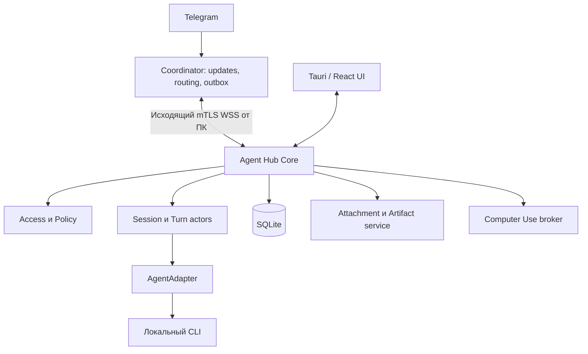

# Agent Hub — исследование и архитектурный план

**Дата исследования:** 28 октября 2026 года.  
**Целевой документ:** `C:\Users\rom4u\Documents\ChatGPT\Agent Hub\AGENT_HUB_PLAN.md`.  
**Статус:** исследование сохранено; создана первая сборка MVP 0.1.0. Полная приёмка MVP ещё не завершена; фактическая реализация и ограничения — в `IMPLEMENTATION_STATUS.md`.

## 1. Executive Summary

Agent Hub следует разрабатывать как самостоятельное приложение с универсальным Rust Core, а не как форк одного из исследованных Telegram-мостов.

Рекомендуемые решения:

1. **Rust + Tokio, Tauri 2, React + TypeScript, SQLite.** В первой версии Core работает внутри процесса Tauri; скрытие окна сохраняет работу в трее.
2. **Официальные структурированные интерфейсы CLI:** Codex app-server, Claude Code stream-json/control protocol, OMP RPC. PTY не входит в основной путь.
3. **Один владелец Telegram updates.** MVP работает напрямую с одним ПК. Для нескольких ПК добавляется опциональный координатор на небольшом сервере; ПК устанавливают исходящие mTLS-соединения.
4. **Точечное переиспользование Telecodex:** Telegram-клиент, ограничитель частоты, форматирование, часть вопросов и Codex-протокола. Хранилище, универсальные события, безопасность и управление Windows-процессами создаются отдельно.
5. **Безопасность с явными границами:** PIN — дополнительный барьер, Telegram не обеспечивает E2EE, relay является доверенным компонентом, Job Objects не являются файловой песочницей.

**MVP:** один ПК, три адаптера с честной матрицей возможностей, Telegram-чат, PIN, проекты, сессии, потоковый ответ, интерактивные запросы, файлы, отмена, аудит, трей.

**v1.0:** несколько ПК, устойчивый relay, Topics, локальная транскрипция, опциональный Computer Use, подписанные обновления и завершённая Windows-приёмка.

**После v1.0:** дополнительные адаптеры, отдельный пользовательский daemon, усиленная изоляция, более глубокая интеграция с нативными приложениями.

В документе используются обозначения:

| Обозначение | Значение |
|---|---|
| **Подтверждено** | Проверено по исходникам, документации или локальному `--help` |
| **Проектное решение** | Предлагаемое поведение Agent Hub |
| **Условная поддержка** | Зависит от версии, модели, аккаунта или доступного протокола |
| **Не подтверждено** | Не включается в обещанные возможности релиза |

Исследование было статическим. Реальные агентские задачи, approvals, Telegram-обмен и Computer Use в Windows не запускались.

## 2. Анализ HeyAgent и Telecodex

### 2.1. Зафиксированные версии

| Компонент | Исследованный срез |
|---|---|
| HeyAgent | `54478b5229dbbfd33a7500fe979f7c6ef123e9d6`, пакет `2.0.0` |
| Telecodex | `58d2f64aa9d26573c13d85cbc918771625157473`, пакет `0.1.0` |
| OMP | `76772d0c9729d95db30b60a7949dfbfdf47fd7f0`, upstream `18.13.3` |
| Codex | upstream release `0.165.0`; локально установлен `0.160.1` |
| Claude Code | upstream release `2.1.312`; локально установлен `2.1.291` |
| OMP локально | `18.1.11` |
| Tauri | ветка 2; актуальный найденный release CLI — `2.12.4` |
| Telegram | документация Bot API 10.3 |

Версия CLI Tauri не считается автоматически версией всех Rust- и npm-пакетов Tauri. Для реализации зависимости фиксируются согласованным lockfile.

Ссылки на исследованные состояния: [HeyAgent](https://github.com/gergomiklos/heyagent/tree/54478b5229dbbfd33a7500fe979f7c6ef123e9d6), [Telecodex](https://github.com/Headcrab/telecodex/tree/58d2f64aa9d26573c13d85cbc918771625157473), [OMP](https://github.com/can1357/oh-my-pi/tree/76772d0c9729d95db30b60a7949dfbfdf47fd7f0), [Codex releases](https://github.com/openai/codex/releases), [Claude Code releases](https://github.com/anthropics/claude-code/releases), [Telegram changelog](https://core.telegram.org/bots/api-changelog).

### 2.2. HeyAgent

**Архитектура.** Node.js-приложение: основной bridge, два provider-модуля, общий subprocess runner, Telegram wrapper и JSON-конфигурация. Зависимости включают `cross-spawn`, `node-telegram-bot-api`, `@inquirer/prompts`, `cloudflared`, `qrcode-terminal`. [Манифест](https://github.com/gergomiklos/heyagent/blob/54478b5229dbbfd33a7500fe979f7c6ef123e9d6/package.json).

**Запуск и вывод.** Claude запускается через print mode с JSON-ответом, Codex — через `exec --json`. Общий runner накапливает stdout/stderr в строках; bridge отправляет результат после завершения вызова. Наличие JSONL у Codex здесь не превращается в полноценную потоковую доставку событий. Отмена использует `SIGTERM`, установлен таймаут процесса. [Runner](https://github.com/gergomiklos/heyagent/blob/54478b5229dbbfd33a7500fe979f7c6ef123e9d6/src/process-runner.js), [Claude provider](https://github.com/gergomiklos/heyagent/blob/54478b5229dbbfd33a7500fe979f7c6ef123e9d6/src/providers/claude-provider.js), [Codex provider](https://github.com/gergomiklos/heyagent/blob/54478b5229dbbfd33a7500fe979f7c6ef123e9d6/src/providers/codex-provider.js).

**Сессии и очередь.** Есть продолжение последней/указанной сессии, переключение provider, `/new`, `/stop`. Сообщения, полученные во время работы, объединяются для следующего запуска. Это последовательная очередь, а не steering текущего turn. Pairing проверяет private chat, затем chat ID и сохранённый user ID. [Bridge](https://github.com/gergomiklos/heyagent/blob/54478b5229dbbfd33a7500fe979f7c6ef123e9d6/src/bridge.js).

**Вложения.** Telegram-файлы скачиваются и включаются в промпт через локальный путь. Это не универсальный typed multimodal transport и не гарантия, что конкретная модель прочитает содержимое. В дереве присутствует `voice-transcriber.js`, но исследованный основной bridge не подключает его: голосовое сообщение сопровождается подсказкой про диктовку. Наличие файла транскрипции не считается работающей интеграцией.

**Безопасность.** `applyDefaultBypassArgs` автоматически добавляет Claude `--dangerously-skip-permissions` либо Codex `--dangerously-bypass-approvals-and-sandbox`, если пользователь не указал другие режимы. Это поведение **не переносить**. Bot token хранится в обычной JSON-конфигурации. Опциональная настройка через Cloudflare Tunnel не соответствует выбранному для Agent Hub локальному onboarding. [Defaults](https://github.com/gergomiklos/heyagent/blob/54478b5229dbbfd33a7500fe979f7c6ef123e9d6/src/args.js), [Config](https://github.com/gergomiklos/heyagent/blob/54478b5229dbbfd33a7500fe979f7c6ef123e9d6/src/config.js).

**Windows.** `cross-spawn` помогает запускать команды, но это не доказательство корректного завершения дерева дочерних процессов, обработки сна или защищённого хранения секретов.

**Вывод:** использовать идеи короткого onboarding, понятных команд и объединения сообщений. Node.js runtime и управляющий код не переносить.

### 2.3. Telecodex

**Архитектура.** Rust-приложение на Tokio с собственным HTTP-клиентом Telegram, SQLite через `rusqlite`, Codex runner, обработчиками сессий/Topics, вопросами, артефактами и опциональной транскрипцией. Исследованный `Cargo.toml` указывает репозиторий AlterMundi, хотя исходный URL задачи — Headcrab; перенос необходимо привязывать к зафиксированному commit. [Cargo.toml](https://github.com/Headcrab/telecodex/blob/58d2f64aa9d26573c13d85cbc918771625157473/Cargo.toml).

**CLI-протокол.** Реализованы app-server transport, `turn/steer`, запросы command/file approvals и native user input. Есть собственные Codex-specific события. Неизвестный server request приводит к ошибке; универсального покрытия всех будущих методов нет. Windows-ветка умеет обрабатывать `.cmd/.bat`, но завершение через `child.kill()` не равно завершению всего дерева процессов. [Codex runtime](https://github.com/Headcrab/telecodex/blob/58d2f64aa9d26573c13d85cbc918771625157473/src/codex.rs).

**Telegram.** Реализованы редактирование сообщений, drafts, групповые/личные интервалы отправки, обработка `retry_after`, очистка token из сообщений об ошибках. Ограничитель хранит состояние в памяти; его нельзя считать готовым durable outbox. [Telegram client](https://github.com/Headcrab/telecodex/blob/58d2f64aa9d26573c13d85cbc918771625157473/src/telegram.rs).

**Перезапуск и дубли.** SQLite содержит session/turn state, ACL, аудит, учёт входящих updates и блокировку экземпляра. При перезапуске неопределённо обработанные updates переводятся в `undetermined`, а старые running turns — в failed. Это правильная защита от слепого повторения команд, но не автоматическое продолжение незавершённого исполнения. [Store, строки 54–95](https://github.com/Headcrab/telecodex/blob/58d2f64aa9d26573c13d85cbc918771625157473/src/store.rs#L54-L95).

**Вложения.** Входящие файлы записываются в `.telecodex/inbox`; исходящие собираются из каталога результатов. В исследованном sender за один проход берутся до десяти файлов, изображения отправляются как photo. Для Agent Hub нужны отдельные правила originals, reparse points, квот и подтверждения экспорта. [Входящие файлы](https://github.com/Headcrab/telecodex/blob/58d2f64aa9d26573c13d85cbc918771625157473/src/app/io.rs), [Выходные артефакты](https://github.com/Headcrab/telecodex/blob/58d2f64aa9d26573c13d85cbc918771625157473/src/app/turns.rs#L1363-L1418).

**Ограничения безопасности.** По умолчанию `workspace-write` сочетается с approval policy `never`. `never` не означает отключение sandbox, но не обеспечивает желаемый интерактивный approval UX. PIN, Windows Credential Manager и multi-PC identity не являются готовыми механизмами этого проекта. [Настройки, строки 306–312](https://github.com/Headcrab/telecodex/blob/58d2f64aa9d26573c13d85cbc918771625157473/src/config.rs#L306-L312).

## 3. Сравнение и возможности переиспользования кода

### 3.1. Сравнительная таблица

| Возможность | HeyAgent | Telecodex | Решение Agent Hub |
|---|---|---|---|
| Агенты | Claude, Codex | Codex | Независимые адаптеры |
| Управляющий интерфейс | Запуск команды на запрос | App-server, дополнительные пути | Structured transport |
| Потоковый UI | Итог после выполнения | Draft/edit, progress | Проекция общего event stream |
| Approvals | Default bypass | Command/file approvals | Типизированные запросы, fail closed |
| Вопросы | Нет полноценного protocol UI | Native questions | Отдельный контракт вопросов |
| Steering | Следующий запуск | Native Codex steering | Только при подтверждённой поддержке |
| Сессии | CLI resume | SQLite + native threads | Hub ID отдельно от native ID |
| Входящие вложения | Локальные пути | Inbox, image/file handling | Asset store + native conversion |
| Исходящие файлы | Не подтверждён общий pipeline | Каталог артефактов | Контролируемый экспорт |
| Голос | Модуль не подключён к bridge | Опциональная транскрипция | Отдельный отключаемый компонент |
| Перезапуск | Простая локальная конфигурация | Durable state, uncertain recovery | Inbox/outbox + reconciliation |
| Multi-PC | Нет | Нет целевого решения | Один coordinator |
| Windows lifecycle | Частичный subprocess support | Windows-ветки | Job Objects и системные события |
| Секреты | JSON | Config/token file | Credential Manager |

### 3.2. Что переносить из Telecodex

| Модуль | Решение | Зависимости и необходимые изменения |
|---|---|---|
| `src/render.rs` | Перенести небольшие чистые функции и тестовые случаи | `html-escape`; проверить Unicode, незавершённый Markdown и лимиты Telegram |
| `src/user_input.rs` | Адаптировать | `serde`, коллекции, ошибки; отделить native ID от Hub request ID |
| `src/telegram.rs` | Извлечь HTTP DTO, обработку ошибок и limiter | `reqwest`, `serde`, Tokio; добавить durable outbox, bounded streaming upload/download, классификацию ошибок |
| `src/codex.rs` | Перенести отдельные protocol mappings | Убрать зависимость от Telegram/session store; заменить lifecycle; сверить с выбранной версией app-server |
| `src/app/questions.rs`, `presentation.rs` | Заимствовать UX и state transitions | Переписать на общий Question/Approval service; убрать глобальную привязку к Codex |
| `src/app/turns.rs` | Использовать как reference и источник fixtures | Не переносить монолит обработки turn и Telegram rendering |
| `src/codex_history.rs` | Только ограниченный fallback импорт | Предпочесть native API; файловые форматы считать нестабильными |
| `src/store.rs`, `models.rs`, `app.rs` | Написать отдельно | Схема и orchestration слишком привязаны к Codex/chat/topic |
| `src/config.rs` | Заимствовать отдельные discovery cases | Не переносить token storage, defaults и запуск через shell |
| `src/transcribe.rs` | Отложить до v1.0 | ONNX/model/FFmpeg увеличивают поставку и требуют отдельного лицензионного анализа |

Обязательное правило переноса: фиксировать origin commit, исходный путь, локальные изменения и применимые copyright notices.

Оба проекта используют MIT. В распространяемых копиях и существенных заимствованиях сохраняются текст лицензии и copyright: HeyAgent Team и Alex Novikov соответственно. MIT верхнего проекта не заменяет проверку лицензий зависимостей. [HeyAgent LICENSE](https://github.com/gergomiklos/heyagent/blob/54478b5229dbbfd33a7500fe979f7c6ef123e9d6/LICENSE), [Telecodex LICENSE](https://github.com/Headcrab/telecodex/blob/58d2f64aa9d26573c13d85cbc918771625157473/LICENSE).

Для HeyAgent предпочтительна самостоятельная реализация протокола и UX на Rust. Если алгоритм переносится близко к исходному коду, сохраняется attribution.

## 4. Полная функциональная спецификация

### 4.1. Основной сценарий

`ПК → PIN → CLI → проект → сессия → чат`.

При первом подключении пользователь локально подтверждает Telegram User ID, выбирает разрешённые проекты и задаёт PIN. Имя пользователя Telegram не используется как идентификатор доступа.

| Область | Требуемое поведение |
|---|---|
| Компьютеры | Регистрация, имя, last seen, online/offline, отзыв устройства |
| Агенты | Discovery, версия, статус авторизации, capabilities, выбранный executable |
| Проекты | Добавляются локально; remote UI выбирает только разрешённые записи |
| Сессии | Создать, импортировать, продолжить, переименовать, архивировать |
| Задачи | Запустить, наблюдать, поставить следующее сообщение в очередь, steer, отменить |
| Интерактивность | Approvals и вопросы адресуются конкретному native request |
| Файлы | Несколько вложений, документы, изображения, оригиналы, экспорт результатов |
| История | Последние ответы, журнал turn, выгрузка доступных событий |
| Безопасность | PIN, временный доступ, локальный отзыв, аудит, emergency stop |
| Фон | Tray, autostart, sleep/resume, уведомления |

**Границы первой версии:** один владелец установки; без командного multi-tenant режима, автоматической установки CLI, удалённого изменения произвольных executable/config paths и непрерывной трансляции рабочего стола.

### 4.2. Параллельность

Одна активная задача на session. По умолчанию — до двух активных sessions на ПК, максимум десять ожидающих turn на session.

Для одного проекта действует эксклюзивная блокировка изменяющих задач. Параллельная запись разрешается только в явно зарегистрированных независимых worktree/project roots. Agent Hub не создаёт Git worktree автоматически.

Переключение меню не перенаправляет уже принятый запрос: machine, project, provider и session фиксируются при его принятии.

## 5. Архитектура компонентов



В standalone-режиме Coordinator и Core находятся в одном процессе; сетевого соединения между ними нет.

| Компонент | Ответственность |
|---|---|
| Domain | Типы команд, событий, identifiers, capability descriptors |
| Session/Turn service | State machine, очереди, project locks, cancellation |
| Provider adapters | Протокол и семантика конкретного CLI |
| Process supervisor | Pipes, Job Objects, shutdown, лимиты |
| Telegram gateway | Updates, callbacks, rendering, outbound delivery |
| Access/Policy | PIN, grants, request validation, revocation |
| Storage | Транзакции, migrations, inbox/outbox, история |
| Attachment service | Ingress, квоты, staging, проверка экспорта |
| Computer Use broker | Отдельное временное разрешение на desktop actions |
| Desktop UI | Представление и типизированные вызовы Core |

**Concurrency model:** actor на session, отдельная read loop каждого protocol transport, bounded channels. Ожидание Telegram-ответа не блокирует чтение stdout CLI и обработку отмены.

**Первая версия:** Core — библиотека внутри Tauri. Закрытие окна уничтожает или скрывает WebView, но не Core. Полный выход завершает принадлежащие Hub процессы.

**Отдельный daemon:** после v1.0, если потребуется переживать падение UI или обновлять UI без прерывания tasks. IPC — Windows named pipe с ACL текущего пользователя; не localhost HTTP. Windows service не нужен для интерактивного desktop use и доступа к пользовательской CLI-авторизации.

## 6. Multi-PC и Telegram routing

### 6.1. Сравнение вариантов

| Вариант | NAT и входящие соединения | Доступность | Стоимость | Решение |
|---|---|---|---|---|
| Один локальный координатор | Peer routing требует VPN/relay; публичные порты не нужны при VPN | Координатор должен работать | Без VPS, но расходы на работающий ПК | Альтернатива |
| Небольшой relay/coordinator | Все ПК подключаются наружу по 443 | Не зависит от домашнего ПК | Плановый бюджет 5–15 USD/месяц, не тарифное обещание | Основной multi-PC вариант |
| Tailscale + координатор | NAT traversal, DERP fallback | Всё равно нужен один работающий координатор | Personal имеет бесплатный вариант; проверить применимость | Для личной установки |
| Telegram webhook | Публичный HTTPS endpoint у координатора | Зависит от сервера | Аналогично relay | Не нужен для первого релиза |
| Отдельный bot на ПК | Простой outbound polling | Независимая | Без relay | Не выполняет требование одного бота |
| Несколько poller одного bot token | Конфликтующие владельцы updates | Ненадёжно | — | Запрещено |

Tailscale решает связность, а не владение очередью Telegram updates. DERP переносит зашифрованный трафик между tailnet-узлами. [DERP](https://tailscale.com/docs/reference/derp-servers), [тарифы](https://tailscale.com/pricing).

**Принятое толкование «без входящих портов»:** ни один управляемый ПК не открывает публичный listener. У опционального интернет-coordinator есть HTTPS/WSS endpoint 443. Если запрещены публичные endpoints вообще, используется Tailscale и постоянно включённый координатор внутри tailnet.

### 6.2. Выбранная схема

MVP: `StandaloneCoordinator`, единственный poller локально.

v1.0: отдельный `agent-hub-coordinator` на пользовательском VPS; один экземпляр на bot token. TLS/mTLS завершается в доверенной инфраструктуре coordinator, а сертификат клиента сопоставляется с machine ID.

Переезд poller выполняется управляемо: остановить старого владельца, передать cursor/state, включить нового. Автоматическое HA и leader election не входят в v1.0. При Telegram 409 polling останавливается с сообщением о втором владельце.

### 6.3. Регистрация и транспорт

1. ПК создаёт device key; секрет хранится локально в Credential Manager.
2. Владелец выдаёт одноразовый registration token на 10 минут и проверяет fingerprint coordinator.
3. После регистрации выдаётся credential конкретному machine ID. Registration token аннулируется.
4. ПК устанавливает исходящее mTLS WSS; reconnect — exponential backoff с jitter.
5. Удаление устройства отзывает credential, routing и grants; повторная регистрация требует нового локального подтверждения.

Control envelope содержит `protocol_version`, `message_id`, `machine_id`, `connection_epoch`, `seq`, `correlation_id`, deadline и typed payload. Старый epoch, повторный command ID и неверный target отклоняются.

Heartbeat — каждые 15 секунд; offline — после 45 секунд. Remote-control lease действует 60 секунд и требует продления. При его истечении ПК блокирует новые remote действия, закрывает pending approvals и останавливает remote turn.

Отключение iPhone от сети не равно отключению ПК от coordinator: работа продолжается, пока действуют разрешения и доступен управляющий канал.

### 6.4. Граница доверия relay

Coordinator видит Telegram-сообщения и владеет bot token. mTLS защищает канал и идентичность ПК, но **не доказывает ПК, что команда действительно написана человеком**, если coordinator скомпрометирован.

Поэтому ПК самостоятельно проверяет локальный grant, проект, scope и срок доступа. Изменение доверенных executable, отключение защит, новые проекты и выдача Computer Use требуют локального разрешения.

Полная защита от злонамеренного coordinator потребовала бы дополнительного клиентского подписания на телефоне. Обычный Telegram-бот такого механизма не предоставляет; это не заявляется как свойство v1.0.

## 7. Архитектура CLI-адаптеров

### 7.1. Выбор интерфейса

| Подход | Использование |
|---|---|
| Structured subprocess | Основной транспорт: stdin/stdout, без shell |
| Codex app-server | Основной Codex adapter |
| Claude stream-json/control | Основной Claude adapter, привязанный к протестированной версии |
| OMP RPC | Основной OMP adapter |
| Официальный SDK | Источник контрактов; использовать библиотеку, когда подходит runtime |
| `exec --json` | Ограниченный batch fallback, не замена интерактивного адаптера |
| PTY | Будущий fallback с ограниченными capabilities |
| Парсинг текста терминала | Только отображение; не источник доверенных approvals |

### 7.2. Codex

Использовать локальный `codex app-server` со stdio. После `initialize`/`initialized` — native thread и turn API, model list, account state, limits и server requests.

Обрабатывать command/file approvals, user input, permissions requests и MCP elicitation отдельно. Неизвестный обязательный запрос не превращается в разрешение: вернуть предусмотренную протоколом ошибку/отказ либо остановить turn.

Зафиксировать официальную protocol schema для поддерживаемых релизов. Codex app-server остаётся изменяемым интерфейсом; неизвестная версия требует qualification, а не только сравнения номера. [App-server documentation](https://developers.openai.com/codex/app-server), [официальные server request types](https://github.com/openai/codex/blob/ce2d47bdc4dd2513d5b3567090593b07b0fdfa0a/codex-rs/app-server-protocol/src/protocol/common.rs).

Начальная политика: sandbox `workspace-write`, approvals `on-request`, без bypass и без неявного расширения writable roots. Уже установленные managed restrictions не ослабляются.

### 7.3. Claude Code

Основной процесс:

```text
claude --print
       --input-format stream-json
       --output-format stream-json
       --verbose
       --include-partial-messages
       --permission-mode manual
       --permission-prompt-tool stdio
       --permission-prompts host
```

Аргументы передаются раздельно; конкретный набор применяется только к квалифицированной версии. Native stdin остаётся открытым для control responses.

Структурированный control protocol подтверждён официальным Python SDK: `control_request`, `control_response`, cancellation, `can_use_tool`, initialize и управляющие операции. Маршрутизация permission host через `stdio` прямо присутствует в SDK. Это реализуемая Rust-интеграция, но не обещание стабильного независимого Rust API. [Control implementation](https://github.com/anthropics/claude-agent-sdk-python/blob/2d485201617258867dd0f74b9e7307056f5938fe/src/claude_agent_sdk/_internal/query.py), [настройка permission transport](https://github.com/anthropics/claude-agent-sdk-python/blob/2d485201617258867dd0f74b9e7307056f5938fe/src/claude_agent_sdk/types.py#L2281-L2304).

`AskUserQuestion` преобразуется в question request, а не в обычное сообщение. Изменение модели — между turn. Сообщения во время выполнения по умолчанию ставятся в Hub queue: двусторонний transport не объявляется автоматически эквивалентом Codex `turn/steer`.

**Авторизация:** запускать неизменённый установленный CLI и оставлять вход самому Anthropic CLI. Не извлекать и не проксировать OAuth-токены. Официальные документы допускают определённые сценарии запуска неизменённого Claude Code с собственными credentials пользователя, но отдельно ограничивают встроенный claude.ai login и использование подписочных credentials сторонними SDK-продуктами. Поэтому не строить собственную форму входа и не обещать применимость подписки к любому способу интеграции. [Условия Claude Code](https://code.claude.com/docs/en/legal-and-compliance), [Agent SDK](https://platform.claude.com/docs/en/agent-sdk/overview).

### 7.4. OMP

Использовать `omp --mode rpc-ui --approval-mode always-ask`. Не передавать `--no-ui`, `--auto-approve` или `--yolo`.

OMP использует **собственный JSONL-протокол, не JSON-RPC 2.0**. Подтверждены ready/response/events, prompt, steer, follow-up, abort, model control, session switching, history и статистика. [RPC specification](https://github.com/can1357/oh-my-pi/blob/76772d0c9729d95db30b60a7949dfbfdf47fd7f0/docs/rpc.md).

В upstream уже есть MIT Rust SDK. Перенести generated `wire.rs` и frame logic с сохранением происхождения; процессный transport адаптировать к общему supervisor/Tokio. Исследованный SDK использует синхронные channels/threads, а Windows fallback завершает непосредственно child process. [Rust SDK](https://github.com/can1357/oh-my-pi/tree/76772d0c9729d95db30b60a7949dfbfdf47fd7f0/sdk/rust/omp-rpc), [transport source](https://github.com/can1357/oh-my-pi/blob/76772d0c9729d95db30b60a7949dfbfdf47fd7f0/sdk/rust/omp-rpc/src/client.rs).

Для новых версий согласовывать protocol v2 и поддерживать bounded chunk reassembly. Локальная `18.1.11` не считается автоматически совместимой со схемой `18.13.3`.

**Ограничение approvals:** native approval может быть представлен общим `extension_ui_request/select`. Он не содержит эквивалент полноценного Codex permission descriptor. Такой запрос показывается как **native dialog** с точным содержимым и вариантами; не используется для выдачи Hub-разрешений. При отсутствии достаточной связи с действием — локальное подтверждение либо отказ. Текст обычного assistant message никогда не превращается в approval. [RPC UI types](https://github.com/can1357/oh-my-pi/blob/76772d0c9729d95db30b60a7949dfbfdf47fd7f0/packages/coding-agent/src/modes/rpc/rpc-types.ts#L779-L815), [approval implementation](https://github.com/can1357/oh-my-pi/blob/76772d0c9729d95db30b60a7949dfbfdf47fd7f0/packages/coding-agent/src/tools/approval.ts).

### 7.5. Матрица возможностей

| Возможность | Codex | Claude Code | OMP |
|---|---|---|---|
| Потоковые сообщения | Да | Да | Да |
| Tool calls/results | Да | Да | Да |
| Структурированные approvals | Да | Control protocol | Частично: generic UI |
| Вопросы пользователя | Native request | AskUserQuestion | UI requests/ask |
| Steering текущего turn | Да | Не обещается; очередь по умолчанию | Да |
| Cancel | Interrupt | Control interrupt | Abort |
| Resume | Native thread | Session ID | Native session path/ID |
| Импорт списка сессий | Native API предпочтителен | Ограниченный локальный importer | Локальное перечисление + native open |
| Несколько изображений | При поддержке модели | При поддержке модели | При поддержке модели |
| Произвольные документы | Staged files | Staged files/поддерживаемый content | Staged files |
| Выходные файлы | Native references + Hub export | Hub export | Native references + Hub export |
| Модели/режимы | Native API | Version-dependent control | Native RPC |
| Usage | Да, когда выдано | Result/usage | Session stats |
| Лимиты аккаунта | Native API, если доступны | Не универсальное обещание | Provider-dependent |
| OS sandbox native Windows | Есть механизмы Codex | Нет Bash sandbox | Не подтверждён общий OS sandbox |

### 7.6. Добавление новых CLI

Встроенные адаптеры используют `AgentAdapter`. Внешние — отдельный локальный executable с версионированным stdio-протоколом Agent Hub.

Manifest содержит provider ID, adapter protocol version, executable reference и capabilities. Это позволяет добавить provider без изменения Core и без нестабильного Rust dylib ABI.

Плагин считается доверенным локальным кодом. Установка и смена executable доступны только через desktop UI; Telegram не может добавлять исполняемые адаптеры.

## 8. Система событий и approvals

### 8.1. Event envelope

Каждое событие содержит:

```text
schema_version
event_id
machine_id
provider_id
session_id
turn_id?
process_generation
sequence
occurred_at
native_ref?
payload
```

`sequence` монотонен внутри Hub session. `native_ref` хранит исходные identifiers, но не используется вместо Hub identity.

| Событие | Содержимое |
|---|---|
| `message` | Роль, content blocks, delta/snapshot, message ID |
| `reasoning_summary` | Только предоставленное provider краткое описание |
| `tool_call` | Call ID, tool name, аргументы, статус |
| `tool_result` | Call ID, результат/ошибка, ссылки на assets |
| `approval_request` | Request ID, scope, action, варианты, deadline |
| `user_question` | Вопросы, варианты, возможность свободного ответа |
| `progress` | Фаза и native status без выдуманного процента |
| `file` / `image` | Asset ID, MIME, размер, происхождение |
| `error` | Категория, retryability, безопасное описание |
| `completed` | completed/failed/cancelled, итоговая usage |

Неизвестные native события сохраняются в ограниченном диагностическом виде и показываются как unsupported/progress; они не создают управляющих действий.

«Полный вывод» означает полный **доступный и разрешённый к экспорту** журнал событий. Скрытые reasoning tokens, недоступные события и redacted secrets не реконструируются.

### 8.2. Approval lifecycle

`pending → approved_once | denied | expired | cancelled | obsolete`.

Approval связывается с machine, session, turn, process generation, native request ID и digest действия. Изменившееся действие требует нового запроса.

Telegram callback содержит короткий случайный opaque token. На сервере проверяются user ID, chat/topic, grant, deadline, текущий turn и состояние запроса. Consume выполняется транзакционно; второе нажатие ничего не исполняет.

По умолчанию доступны **«Разрешить один раз»**, **«Отказать»**, **«Остановить задачу»**. Persistent/session-wide grants из native CLI не выдаются автоматически.

Разрешение опасных действий не выводится из «да» в обычном чате. При таймауте — отказ. После перезапуска процесса старые approval IDs недействительны.

### 8.3. Вопросы

Свободный ответ принимается только как reply к конкретному вопросу или после явного выбора активного question ID. Если вопросов несколько, бот показывает picker.

Ответ вопросу не становится новым turn. Отмена вопроса отправляется native-протоколом; если протокол не поддерживает отказ, turn останавливается с объяснением.

## 9. Передача файлов и изображений

### 9.1. Ingress

Вложение проходит `received → quarantined → validated → staged → attached`.

Файлы сначала сохраняются в закрытый каталог Hub под случайными именами. Оригинальное имя хранится как metadata. Пользовательский путь, расширение и MIME из Telegram не считаются доверенными.

Проверяются размер во время streaming download, MIME/signature, число пикселей, отсутствие traversal, ADS, device names и reparse-point обходов. Архивы не распаковываются автоматически; документы не запускаются.

Для native CLI создаётся отдельный staging directory внутри разрешённого проекта. Это делает доступ явным и не требует открывать весь каталог данных Hub. Служебные файлы не добавляются в Git и не меняют `.gitignore` без отдельного действия.

### 9.2. Несколько вложений

Сообщения media group собираются в draft, привязанный к выбранной session. Для нескольких отдельных файлов используется кнопка **«Отправить N вложений»**; смена выбора ПК не меняет адрес уже созданного draft.

Изображения передаются native image content, если adapter/model это поддерживает. Иначе отправка не маскируется под успешное vision-восприятие: предлагается файл либо явное сообщение о неподдерживаемом формате.

### 9.3. Оригинальное качество

Telegram photo может быть уже сжат. Для сохранения оригинала UI рекомендует отправлять изображение как **файл/document**.

В обратном направлении оригинал отправляется через `sendDocument`; photo preview создаётся отдельно. Hub сохраняет SHA-256 полученных байтов, но не утверждает, что они совпадают с исходником на iPhone до Telegram-обработки.

### 9.4. Ограничения

| Ограничение | Решение |
|---|---|
| Cloud Bot API download | До 20 MB; превышение отклоняется до передачи CLI |
| `sendDocument` | До 50 MB; более крупный результат остаётся локально |
| Сообщение | До 4096 символов после entities parsing |
| `callback_data` | 1–64 байта; использовать opaque ID |
| Local Bot API server | Возможное расширение после v1.0; не обязателен |

Источники: [getFile](https://core.telegram.org/bots/api#getfile), [sendDocument](https://core.telegram.org/bots/api#senddocument), [sendMessage](https://core.telegram.org/bots/api#sendmessage), [InlineKeyboardButton](https://core.telegram.org/bots/api#inlinekeyboardbutton).

### 9.5. Экспорт и голос

Provider предлагает asset reference, но не может произвольно заставить Hub отправить любой локальный файл. Экспорт разрешён из выделенного outbox, после проверки final path/handle, размера и policy. Неизвестный файл либо файл вне проекта требует локального разрешения.

Голос в MVP принимается как вложение; автоматическая транскрипция — v1.0, отдельно включаемый локальный компонент. Выбранный базовый путь — `whisper.cpp` с мультиязычной моделью и проверяемой загрузкой; модель, FFmpeg и их лицензии не включаются в основной установщик без отдельного packaging review.

## 10. Computer Use

### 10.1. Исследованные решения

| Решение | Подтверждённые свойства | Вывод |
|---|---|---|
| CursorTouch Windows-MCP | Windows 10/11, Python 3.14+, UIA, input, screenshots; MIT верхнего проекта | Подходит как опциональный внешний backend после ограничений и проверки зависимостей |
| Terminator | Windows-oriented Rust SDK/MCP, UI Automation, screenshots; MIT репозитория | Рассматривать отдельные библиотеки; не переносить весь стек |
| Playwright MCP | Browser automation через accessibility/snapshots; Apache-2.0 | Использовать отдельно для браузера, не считать управлением Windows |
| Native Computer Use приложений | Доступность из конкретного CLI не доказана автоматически | Не включать как бесплатную встроенную возможность |

У Windows-MCP ownership gating отделён от разрешений на действия. В зависимости от политики PowerShell, registry и другие инструменты могут обходить desktop ownership gate. Это не готовая security boundary. [Control policy](https://github.com/CursorTouch/Windows-MCP/blob/fbb2ac612831f0a42fa641f1cdd058c928c12b39/src/windows_mcp/tools/control_policy.py).

Дополнительно `pyproject.toml` включает `fuzzywuzzy` и `python-Levenshtein`, чьи опубликованные лицензии относятся к GPL. Нельзя считать весь распространяемый bundle permissive только из-за MIT верхнего проекта. [Зависимости](https://github.com/CursorTouch/Windows-MCP/blob/fbb2ac612831f0a42fa641f1cdd058c928c12b39/pyproject.toml), [fuzzywuzzy](https://pypi.org/project/fuzzywuzzy/), [python-Levenshtein](https://pypi.org/project/python-Levenshtein/).

Terminator также имеет существенные зависимости: UIA, Windows APIs, OCR, image capture и сетевые компоненты. [Rust crate](https://github.com/mediar-ai/terminator/blob/73a381c0c1c33eda55f2c0ecb1d918bf5ec7561a/crates/terminator/Cargo.toml), [Playwright MCP](https://github.com/microsoft/playwright-mcp).

### 10.2. Выбранная архитектура

Computer Use отключён по умолчанию. В v1.0 создаётся узкий Rust broker с операциями:

```text
list_windows
capture_window / capture_screen
inspect_ui
invoke_element
click / type_text / key_sequence / scroll
```

Broker реализует локальный MCP stdio endpoint; контроль и permissions остаются в Core. Начальный backend — Windows APIs/UI Automation с использованием готовых библиотек после dependency review. Универсальные PowerShell/Registry/FileSystem инструменты не входят в его API.

Разрешение выдаётся локально на 10 минут, для конкретных приложений/окон и набора действий. Полный экран, clipboard и ввод credentials требуют отдельных scopes.

Перед input проверяются identity окна, PID/start time, актуальность UI element и foreground state. Координаты из старого screenshot не исполняются без проверки.

### 10.3. Ограничения и аварийная остановка

На locked desktop, UAC secure desktop и при переходе пользователя действия прекращаются. Повышение привилегий не используется. `SendInput` ограничен UIPI и не предоставляет общего контроля над процессами более высокого integrity level. [Microsoft SendInput](https://learn.microsoft.com/en-us/windows/win32/api/winuser/nf-winuser-sendinput).

Emergency stop доступен из трея, горячей клавишей `Ctrl+Alt+Shift+F12` и Telegram. Он отзывает lease, запрещает новые действия, освобождает удерживаемые клавиши/кнопки и завершает принадлежащий Hub broker.

Для Unreal Engine предпочтителен специализированный MCP/editor interface. UIA полезна для доступных окон и контролов, но полноценное покрытие Slate, viewport и игрового ввода не обещается.

## 11. Модель безопасности

### 11.1. Активы и trust boundaries

Защищаются project files, credentials, session contents, bot token, device keys, право запуска команд, рабочий стол и журнал действий.

Недоверенные входы: Telegram text/files, содержимое репозитория, tool output, модельный текст, внешние adapters/MCP и relay messages до проверки.

Trusted computing base: Windows user session, Hub executable, выбранные CLI, одобренные adapters/MCP и coordinator. Произвольный вредоносный код под тем же Windows-пользователем находится за пределами гарантий одной только Credential Manager.

### 11.2. Threat model

| Угроза | Меры | Остаточный риск |
|---|---|---|
| Захват Telegram-аккаунта | User ID binding, PIN, expiry, локальный revoke | PIN мог сохраниться в cloud chat |
| Кража bot token | OS secret store, redaction, ротация | Возможны перехват updates и поддельные сообщения бота |
| Перебор PIN | Argon2id, pepper, persistent rate limits | Короткий PIN имеет низкую энтропию |
| Утечка PIN | Не писать в DB/logs; best-effort удаление сообщения | Удаление не доказывает исчезновение всех копий |
| Replay | Command ID, request ID, epoch, deadline, atomic consume | Нельзя отменить уже выполненный побочный эффект |
| Prompt injection | Разделение data/control, sandbox, явные approvals | Модель может предлагать нежелательные действия |
| Вредоносный файл | Квоты, signature check, quarantine, отсутствие auto-exec | Уязвимости parsers/CLI сохраняются |
| Подмена approval | Только native protocol, binding и digest | Компрометация самого CLI ломает доверие |
| Shell injection | Native executable + argv/stdin, без shell strings | Одобренная shell-команда агента сама обладает силой shell |
| Выход за проект | Hub path policy + provider sandbox, reparse checks | Application checks не ограничивают все действия unsandboxed CLI |
| Эскалация | Standard user, no elevation API, local-only policy changes | Авторизованные внешние приложения могут иметь свои brokers |
| Компрометация relay | mTLS, local grants, local-only privileged actions | Relay остаётся доверенным источником remote intent |
| WebView/XSS | CSP, typed IPC, sanitized rendering, no remote pages | Уязвимость renderer требует обновлений |
| Подмена обновления | HTTPS, updater signature, Authenticode, anti-downgrade policy | Компрометация signing keys |
| Утечка журналов | Минимизация, redaction, quotas, export consent | Произвольные секреты внутри текста распознаются не всегда |

### 11.3. PIN и временный доступ

Поддержать 4–6 цифр; default — 6. PIN не использовать как encryption key или device enrollment credential.

Хранение: `Argon2id(HMAC-SHA-256(device_pepper, PIN), random_salt)`. Стартовые параметры Argon2id: 64 MiB, 3 прохода, parallelism 1; pepper — в Credential Manager. Это проектный baseline с последующим измерением на целевом ПК. [OWASP Argon2 guidance](https://cheatsheetseries.owasp.org/cheatsheets/Password_Storage_Cheat_Sheet.html).

Пять неудач за 15 минут блокируют remote PIN-проверку на 15 минут; повторные блокировки увеличивают срок до 24 часов. Счётчики действуют и на user/machine, и на machine в целом, переживают перезапуск. Unknown users отклоняются до дорогого hashing.

Grant привязан к user, machine, project scopes и auth epoch. Idle expiry — 15 минут, абсолютный срок — 8 часов. Restart, смена PIN и revoke аннулируют grants. Автоматическое снятие lockout через Telegram не допускается.

### 11.4. Секреты и Tauri

Bot token, pepper и device secrets на Windows хранятся через Credential Manager. В SQLite — только references. CLI самостоятельно владеет своей авторизацией; Hub не копирует auth-файлы.

Frontend получает только необходимые DTO. Не выдавать React общий shell/fs/process API. CSP — локальные assets, без remote scripts, `unsafe-eval` и загрузки произвольных страниц. Agent Markdown/HTML не исполняется.

Tauri capabilities ограничиваются конкретным окном; каждый custom command дополнительно проверяет policy в Rust. Capabilities не заменяют авторизацию внутри Core. [Tauri security](https://v2.tauri.app/security/), [capabilities](https://v2.tauri.app/security/capabilities/).

На Linux-coordinator используются OS secret facilities и закрытые credentials, а не Windows Credential Manager. Plaintext secrets в TOML, command line и логах запрещены.

### 11.5. Настоящая изоляция

| Механизм | Что даёт | Чего не даёт |
|---|---|---|
| Hub allowlist | Контролирует запросы через Hub | Не изолирует произвольный CLI subprocess |
| Job Object | Lifecycle, лимиты ресурсов, завершение дерева | Не запрещает чтение файлов и сеть |
| Restricted token | Ограничивает Windows access checks | Требует корректных ACL; может ломать CLI |
| AppContainer | OS security boundary с capabilities | Не является прозрачной оболочкой для любого developer CLI |
| Provider sandbox | Практическое ограничение tool execution | Различается по платформам и версиям |
| VM/Windows Sandbox | Более сильная среда | Дополнительная стоимость ресурсов и сложность credentials/desktop integration |

Источники: [Job Objects](https://learn.microsoft.com/en-us/windows/win32/procthread/job-objects), [restricted tokens](https://learn.microsoft.com/en-us/windows/win32/secauthz/restricted-tokens), [AppContainer](https://learn.microsoft.com/en-us/windows/win32/secauthz/appcontainer-isolation).

Для Codex использовать поддерживаемый Windows sandbox и показывать его фактический статус. Если sandbox требует отдельной настройки, Hub сообщает об этом, но не запускается постоянно от администратора. [Codex Windows](https://developers.openai.com/codex/windows).

Claude Bash sandbox доступен на macOS, Linux и WSL2; native Windows-команды выполняются без него. Native Windows-профиль Claude/OMP обозначается как **«контроль разрешений, без подтверждённой OS-изоляции»** и требует локального включения. WSL2 — опциональный профиль, не доказательство безопасности при разрешённом выходе в Windows interop. [Claude sandbox](https://code.claude.com/docs/en/sandboxing).

Telegram cloud chat не является Secret Chat. PIN и task data видны инфраструктуре Telegram; E2EE между iPhone и Hub не заявляется. [Telegram encryption model](https://telegram.org/faq#q-why-not-just-make-all-chats-secret).

## 12. Tauri UI и UX

### 12.1. Экраны

| Экран | Основное содержимое |
|---|---|
| Агенты | Обнаружение CLI, версия, подключение, ограничения изоляции |
| Telegram | Bot token, локальное подтверждение User ID, PIN, подключение и отзыв доступа |
| Настройки | Разрешённые папки, autostart, тема, аудит, сведения о сборке |

**Уточнение владельца от 28.10.2026:** desktop — компактный Telegram-мост, без отдельных экранов «Обзор», «Проекты», «Сессии» и «Безопасность». Управление сессиями и задачами находится в Telegram; разрешённые project roots остаются частью Core и настраиваются локально. Pending requests показываются контекстными карточками поверх текущего раздела, аварийная остановка доступна постоянно.

Использовать Fluent UI React 9, системные шрифты, light/dark/high-contrast темы и видимый keyboard focus. Статусы не кодировать только цветом. Mica/эффекты необязательны и не влияют на функциональность.

### 12.2. Telegram UX

Один текущий progress message на turn, отдельные actionable cards и итоговый ответ. Tool events агрегируются: «Читает 4 файла», «Выполняет команду», «Ожидает ответ». Полный журнал выдаётся по кнопке, а не тысячами сообщений.

Команды: `/start`, `/pcs`, `/sessions`, `/status`, `/stop`, `/lock`, `/help`. Остальные действия доступны inline-кнопками. `/stop` останавливает выбранный turn; глобальная остановка требует отдельного явно подписанного действия.

Все карточки содержат краткие machine/project/session labels. Ответ на старую карточку остаётся привязан к её session; не переадресуется текущим выбором меню.

### 12.3. Topics и streaming

MVP — private chat с session picker. v1.0 — private topics, когда включён соответствующий режим бота; group topics остаются дополнительным режимом с явным предупреждением о видимости сообщений участникам.

Актуальный Bot API поддерживает создание topics также в private chat. Не нужно искусственно требовать supergroup только ради раздельных задач. [createForumTopic](https://core.telegram.org/bots/api#createforumtopic).

Базовый streaming — редактирование сообщения с интервалом 1,5 секунды и только при изменении содержимого. Drafts — опциональная оптимизация: они временные и требуют финального `sendMessage`. [sendMessageDraft](https://core.telegram.org/bots/api#sendmessagedraft).

### 12.4. Windows-поведение

Close → tray; Exit → graceful shutdown. Autostart — при входе пользователя, с явным opt-in. При активной задаче tray показывает состояние; уведомления по умолчанию скрывают содержание промптов и файлов.

Sleep запрещает новые действия и помечает transport stale. После resume — reconnect, повторная проверка lease и process/session reconciliation. Hub не меняет системные power settings.

Установщик — per-user NSIS, WebView2 Evergreen. Проверка обновлений не останавливает задачи; установка выполняется после их завершения либо явного подтверждения отмены. Updater signature и Windows Authenticode решают разные задачи и нужны оба. [Tray](https://v2.tauri.app/learn/system-tray/), [autostart](https://v2.tauri.app/plugin/autostart/), [installer](https://v2.tauri.app/distribute/windows-installer/), [updater](https://v2.tauri.app/plugin/updater/).

## 13. Структура Rust workspace и каталогов

```text
agent-hub/
  Cargo.toml
  Cargo.lock
  apps/
    desktop/
      src-tauri/
      src/
    coordinator/
  crates/
    hub-domain/
    hub-core/
    hub-storage/
    hub-platform-windows/
    hub-telegram/
    hub-transport/
    hub-agent-api/
    hub-agent-codex/
    hub-agent-claude/
    hub-agent-omp/
    hub-computer-use/
  tests/
    fixtures/
    contract/
    integration/
    windows-e2e/
  docs/
    architecture/
    security/
    compatibility/
  third_party/
    notices/
```

Это логическое разделение библиотек, не набор микросервисов. В MVP один исполняемый desktop process плюс дочерние CLI; coordinator появляется с multi-PC.

| Слой | Основные зависимости |
|---|---|
| Core | Tokio, tokio-util, serde, thiserror, tracing, uuid |
| Storage | rusqlite с bundled SQLite; один выделенный DB worker |
| Telegram | reqwest/rustls, serde, multipart streaming |
| Security | argon2, zeroize/secrecy, OS credential API, OS CSPRNG |
| Windows | windows crate: processes, Job Objects, named objects, UIA/input |
| Relay | axum, rustls, WebSocket transport |
| Desktop | Tauri 2, React, TypeScript, Fluent UI |

Runtime data размещаются под `%LOCALAPPDATA%\AgentHub`: database, logs, attachments, staging metadata и backups. Credential payloads туда не записываются.

Пути CLI home не меняются автоматически. Разные `CODEX_HOME`/Claude/OMP profiles учитываются в native session identity.

## 14. Схема SQLite

### 14.1. Основные таблицы

| Таблица | Основные поля и ограничения |
|---|---|
| `machines` | ID, name, device identity, state, last_seen, auth_epoch |
| `providers` | ID, executable, version, protocol, capabilities, qualification |
| `projects` | ID, machine ID, canonical root, filesystem identity, policy |
| `sessions` | ID, project/provider, native ID/profile, title, lifecycle |
| `turns` | ID, session, command ID UNIQUE, state, process generation, times |
| `events` | Session ID, sequence, turn ID, type, payload; UNIQUE(session, sequence) |
| `commands` | ID, target, auth context, payload digest, state, expiry |
| `incoming_updates` | Bot ID + update ID UNIQUE, sanitized payload, handling state |
| `outbox` | Delivery ID, event reference, route, method, attempt, next_retry, message ID |
| `telegram_routes` | Bot/chat/topic/user, selected machine/session, version |
| `authorized_users` | Machine/user binding, enabled, local approval time |
| `pin_state` | Machine ID, Argon2 PHC, pepper reference, failures, lockout |
| `access_grants` | ID, user, machine, scopes, idle/absolute expiry, epoch, revoked |
| `interaction_requests` | ID, kind, native ref, action digest, deadline, decision |
| `assets` | ID, hash, size, MIME, storage ref, owner, direction, retention |
| `drafts` | Route/session, text, asset references, expiry |
| `audit_log` | Sequence, actor, action, target, result, redacted metadata |
| `schema_migrations` | Version, checksum, applied_at |

UUID сохраняются единообразно; Telegram identifiers — signed 64-bit integers. Timestamp — UTC. Секретный PIN никогда не попадает в `incoming_updates`, event payload или audit.

### 14.2. Хранение и транзакции

SQLite: WAL, foreign keys, `busy_timeout`; критические inbox/command/approval transitions используют durable transactions. Синхронный `rusqlite` работает в выделенном worker, не блокирует Tokio executor.

Принятие команды и создание pending turn атомарны. Approval consume и decision record атомарны. Event append и соответствующая доставка в outbox связаны транзакцией.

Relay и ПК имеют **разные базы**: ПК является источником истины для исполнения, PIN и policy; coordinator — для Telegram cursor/routes/delivery. Общая SQLite на сетевой папке не используется.

### 14.3. Миграции и retention

Миграции нумеруются, имеют checksum и выполняются до запуска workers. Перед destructive migration создаётся консистентный backup. Неизвестная более новая schema открывается только для диагностики, без автоматического downgrade.

Defaults: история 30 дней/1 GiB на ПК, assets 7 дней/2 GiB, operational logs 50 MiB с rotation, metadata-аудит 90 дней. Активные/pinned assets не очищаются. При невозможности сохранить обязательный state новые tasks блокируются.

## 15. Основные интерфейсы и контракты

```rust
trait AgentProvider {
    async fn discover(&self) -> Result<Vec<Installation>>;
    async fn probe(&self, installation: &Installation)
        -> Result<ProviderDescriptor>;
    async fn open(&self, spec: SessionSpec)
        -> Result<Box<dyn AgentSession>>;
}

trait AgentSession {
    async fn submit(&mut self, input: TurnInput)
        -> Result<SubmissionReceipt>;
    async fn steer(&mut self, turn: TurnId, input: TurnInput)
        -> Result<SteerReceipt>;
    async fn respond(&mut self, response: InteractionResponse)
        -> Result<ResponseReceipt>;
    async fn cancel(&mut self, turn: TurnId)
        -> Result<CancelReceipt>;
    async fn reconfigure(&mut self, settings: SessionSettings)
        -> Result<EffectiveSettings>;
    fn events(&mut self) -> EventReceiver;
}
```

Сигнатуры выше — контракт, а не требование конкретного механизма object-safe async. Реализация выбирает единый подход boxed futures/`async-trait`.

`SubmissionReceipt` различает `accepted`, `rejected`, `unknown`. `SteerReceipt` дополнительно сообщает фактический target turn. `unknown` запрещает автоматическую повторную отправку.

`ProviderDescriptor` содержит не bool «поддерживается всё», а capabilities с уровнем `supported / conditional / unsupported`, причиной и ограничениями версии.

Внешний adapter protocol v1 использует length-bounded JSONL: handshake, requests/responses, event notifications и cancellation. Неизвестная major version отклоняется; optional fields совместимы вперёд. Binary assets передаются через выданные Hub references, не произвольные файловые пути.

Tauri-команды принимают IDs и DTO: `list_machines`, `select_session`, `submit_turn`, `answer_request`, `cancel_turn`, `revoke_access`, `export_log`. Универсального `run_shell(string)` нет.

События UI доставляются с cursor; после пропуска frontend запрашивает snapshot плюс события после sequence. Модельные delta не являются единственным источником итогового текста.

## 16. Управление процессами и жизненный цикл сессий

### 16.1. Discovery и запуск

Discovery проверяет известные install paths и доверенный PATH. Текущий project directory не используется для подбора executable. Запускаются только найденные файлы после локального выбора.

`--version`/`--help` имеют таймаут и ограничение stdout. Полная qualification выполняется отдельно, потому что номер версии не доказывает поддержку конкретного native метода.

Нативный `.exe` предпочтительнее `.cmd`. Для Node-based установки разрешён проверенный runtime плюс точный script path; промпты передаются по stdin. Общий shell fallback не включается автоматически.

Дочерний процесс получает минимальное необходимое окружение; bot token, PIN pepper, relay secrets и updater keys туда не передаются.

### 16.2. Windows supervisor

Создать процесс suspended, назначить Job Object с `KILL_ON_JOB_CLOSE`, затем продолжить исполнение. Это закрывает гонку, когда CLI успевает породить потомков до регистрации в Job.

Stdout/stderr читаются независимо; ввод сериализуется writer-task. Все буферы ограничены. Обычный stderr — диагностика, не protocol command.

Отмена: native interrupt → ожидание до 5 секунд → завершение job → ожидание выхода и фиксация результата. Закрытие Hub не убивает чужие экземпляры CLI или открытые пользовательские приложения.

### 16.3. State machine

```text
Session: idle → starting → running ↔ waiting_input
                           ↓
                       cancelling
                           ↓
                     idle / crashed

Turn: queued → dispatching → running → completed
                     │          ├── failed
                     │          ├── cancelled
                     │          └── interrupted
                     └── unknown
```

`waiting_input` — состояние взаимодействия, не освобождение turn lock. Session переключается на другой native context только когда нет активного turn.

### 16.4. Восстановление и нативные приложения

После restart сохраняются Hub history и native session reference. Исполнение прежнего процесса не считается восстановленным. Pending interactions получают obsolete, а сомнительные dispatch — unknown. Продолжение создаёт новый turn после reconciliation.

Codex CLI/app-server могут предоставлять доступ к совместимой локальной истории, но это не равнозначно владению активным turn Codex App. Импорт предпочтительно делает fork либо требует прекращения исходной активности.

Claude Desktop использует отдельный session list; официально описан перенос CLI-сессии в Desktop через `/desktop`. Это не универсальная синхронизация Claude Chat/Cowork/Code с Hub. [Claude Desktop integration](https://code.claude.com/docs/en/desktop).

В v1.0 нет подключения к существующему GUI-процессу агента, перехвата его approvals или одновременной записи в одну native session.

## 17. Надёжность и обработка ошибок

### 17.1. Telegram delivery

Входящий update фиксируется до продвижения polling offset. Дубликаты распознаются по bot/update ID. PIN-сообщения обрабатываются отдельно без сохранения plaintext.

Исходящие доставки имеют durable state. Progress edits объединяются; approvals, вопросы и terminal events получают приоритет.

Начальные бюджеты: до 20 outbound requests/секунду глобально, не чаще одного обычного сообщения/секунду на private chat; для групп — не более 18 сообщений/минуту с общим бюджетом на все topics. Это консервативные настройки Hub, не обещание одинаковых лимитов всех Telegram methods. `retry_after` всегда приоритетнее. [Telegram FAQ](https://core.telegram.org/bots/faq#my-bot-is-hitting-limits-how-do-i-avoid-this).

429 → отложить на `retry_after` плюс jitter. 5xx/network → exponential backoff. 401 → отключить connector и запросить исправление token. 403 → пометить route недоступным. Некорректная разметка → один безопасный plain-text fallback.

### 17.2. Exactly-once не обещается

Telegram `sendMessage` не даёт общего idempotency key. Если ответ потерян после принятия сообщения, повтор может создать дубль. Известные message IDs позволяют делать повторяемые edits; неизвестный исход фиксируется как delivery uncertainty.

Аналогично, crash между отправкой native command и ack нельзя исправлять безусловным resend. Hub обеспечивает durable deduplication и обнаружение неопределённости, а не универсальное exactly-once выполнение внешних действий.

### 17.3. Ошибки CLI и timeouts

| Ситуация | Поведение |
|---|---|
| CLI не найден | Исправить путь локально; не устанавливать автоматически |
| Auth expired | Приостановить dispatch; предложить native login на ПК |
| Unknown protocol version | Ограниченный режим либо отказ запуска |
| Malformed/oversized frame | Protocol error; остановить затронутый transport |
| Потеря stdout до completion | `interrupted/unknown`, без выдуманного успеха |
| Native rate limit | Показать доступный retry/reset; не менять модель самостоятельно |
| Approval timeout | Deny/cancel |
| Disk full | Остановить новый dispatch; сохранить минимальную диагностику |
| Sleep/reconnect | Reconcile, не воспроизводить старые нажатия |
| Emergency stop | Revoke и terminate принадлежащего Hub execution |

Handshake timeout — 30 секунд, локальный probe — 10 секунд, approval — 5 минут, question — 15 минут. Общего короткого timeout на длительную агентскую задачу нет; максимальная длительность задаётся проектом и ограничивается доступом пользователя.

Telegram хранит непрочитанные updates не более 24 часов. После долгого простоя полное восстановление сообщений не гарантируется; бот явно сообщает о возможном пробеле. [Getting updates](https://core.telegram.org/bots/api#getting-updates).

## 18. Стратегия тестирования

| Уровень | Что проверяется |
|---|---|
| Unit/property | State transitions, deduplication, callback consume, expiry, Unicode rendering, path handling |
| Protocol contract | Записанные native frames, unknown fields, malformed data, request/response correlation |
| Integration | SQLite migrations, durable queue, mock Telegram, fake CLI processes, reconnect |
| Windows lifecycle | Job descendants, crash, sleep/resume, Unicode paths, `.exe` discovery, locked files |
| End-to-end | iPhone Telegram → PIN → provider → prompt → interaction → artifact → completion |

Mock adapter должен уметь воспроизводить slow stream, simultaneous questions, approval, crash до/после ack, steering race, oversized frame и отмену с дочерними процессами.

Security tests включают чужой user ID, повторный callback, stale epoch, expired grant, fake approval в model text, traversal, junction/reparse, ADS, HTML injection, утечку token в HTTP error и отозванный device certificate.

Реальные CLI-тесты выполняются отдельно в disposable projects, с известной версией, явным opt-in и контролем расхода аккаунта. Fixtures не содержат credentials и личную историю.

Для UI проверяются клавиатура, high contrast, 100/150/200% DPI и восстановление event cursor. Computer Use испытывается в тестовых приложениях; успешный unit test не заменяет реальный desktop-input тест.

В рамках текущего исследования эти тесты не выполнялись.

## 19. Поэтапный план реализации

Оценки ниже — плановые рабочие дни одного опытного разработчика, без ожидания внешних согласований.

| Этап | Задачи и компоненты | Зависимости | Результат и критерий завершения | Проверки | Оценка |
|---|---|---|---|---|---|
| **A. Qualification** | Зафиксировать версии, native schemas, fixtures, licenses; проверить безопасный минимальный диалог трёх CLI | Установленные CLI и тестовые аккаунты | Для каждой capability известен supported/conditional/unsupported; нет скрытого bypass | Prompt, resume, cancel, approval/question по native интерфейсу | 4–6 дней |
| **B. Core foundation** | Domain, SQLite, actors, mock adapter, Windows supervisor, policy | A | Durable command/event model; crash не вызывает replay; потомки завершаются | State machine, migrations, mock crash matrix, Job Object tests | 7–10 дней |
| **C. Single-PC Telegram** | Pairing, PIN, grants, routing, streaming renderer, inbox/outbox | B | Полный сценарий с mock/Codex, включая reboot и revoke | Mock Bot API, callback replay, 429, PIN lockout | 6–9 дней |
| **D. Три адаптера и файлы** | Codex/Claude/OMP, capabilities UI, attachments, import/resume | A–C | Все три доступны в заявленных границах; исходное качество document сохранено | Contract suite, real CLI smoke, multi-image, unknown dispatch | 10–15 дней |
| **E. MVP desktop** | Три экрана по уточнению владельца, tray, autostart, notifications, per-user installer | B–D | Пользователь управляет одним ПК с iPhone; ограничения видны в UI | Windows E2E, keyboard/DPI, install/uninstall, sleep/resume | 7–10 дней |
| **F. Multi-PC v1.0** | Coordinator, mTLS enrollment, leases, reconnect, route persistence | MVP | Два ПК под одним bot token, один poller, независимые PIN и revoke | NAT scenario, offline PC, duplicate commands, revoked certificate | 8–12 дней |
| **G. v1.0 extensions** | Private Topics, local STT, Computer Use broker | MVP; F для remote multi-PC use | Опциональные функции выключены по умолчанию; scoped desktop control | Real UIA/input, emergency stop, voice consent, artifact delivery | 10–15 дней |
| **H. Release hardening** | Signed updater, Authenticode, dependency notices, recovery UX | F–G | Пройдены security/reliability acceptance tests; recovery documentation готова | Upgrade/rollback constraints, corrupted DB, token rotation, failure injection | 6–10 дней |

**MVP:** этапы A–E, ориентир 34–50 рабочих дней.  
**v1.0:** суммарно 58–87 рабочих дней.

После v1.0: отдельный user daemon, дополнительные providers, усиленные execution profiles, крупные файлы через local Bot API, richer native-app handoff. Эти улучшения не блокируют завершение первой версии.

## 20. Риски, компромиссы и открытые вопросы

| Вопрос | Принятое решение | Альтернатива / условие изменения |
|---|---|---|
| Делать форк Telecodex? | Нет, точечный перенос | Форк ускорит Codex-only bot, но усложнит универсальное ядро |
| Какой multi-PC deployment? | Опциональный trusted VPS coordinator | Tailscale + постоянно включённый ПК при отказе от VPS |
| Нужен daemon сразу? | Нет | Выделить после v1.0 при реальной необходимости переживать UI crash |
| Claude без API оплаты? | Использовать неизменённый CLI и собственную допустимую авторизацию пользователя | SDK/API integration требует отдельного auth/commercial режима |
| Равны ли возможности адаптеров? | Нет, capability matrix — часть продукта | Не обещать parity через парсинг terminal text |
| OMP approvals | Generic native dialogs не выдаются за полноценные permission descriptors | Более богатая поддержка после появления/внедрения проверяемого structured contract |
| Изоляция native Windows | Отображать фактическую, не симулировать | WSL2/VM/отдельный restricted profile |
| Computer Use backend | Узкий Rust broker | Внешний Windows-MCP только после scope/license review |
| Гарантия доставки | Durable retry + явная uncertainty | Exactly-once для Telegram/native side effects недостижимо в общем случае |
| Сессии Desktop | Явный импорт/handoff, не скрытая синхронизация | Shared native server integration после отдельной qualification |
| Низкое потребление памяти | Lazy WebView, bounded buffers, отдельные optional компоненты | Отдельный daemon — если измерения покажут необходимость |
| Полный журнал | Доступные native events с redaction и quotas | Нельзя обещать скрытые reasoning или бесконечное хранение |

Остающиеся вопросы относятся к **квалификации реализации**, а не к выбору архитектуры: точная совместимость установленных старых CLI, Windows sandbox setup на конкретной машине, модель STT и packaging licenses.

Для каждого уже задан безопасный fallback: capability выключена, запрос отклоняется или требуется локальное действие. Реализатор не должен самостоятельно ослаблять policy для обхода блокировки.

Отдельное ограничение: требования «весь доступ только внутри проекта» и «любой native Windows CLI с существующим пользовательским окружением» нельзя одновременно объявлять гарантированными без подходящего OS sandbox. В UI это должно быть видно до выдачи remote access.

## 21. Критерии готовности и приёмочные тесты

| ID | Сценарий | Критерий |
|---|---|---|
| AC-01 | Чистая установка Windows 11 | Per-user приложение запускается без постоянных admin rights |
| AC-02 | Подключение Telegram | User ID подтверждён локально, token не появляется в logs/DB |
| AC-03 | PIN | Неверные попытки блокируются; restart не сбрасывает lockout |
| AC-04 | Полный путь | ПК → PIN → CLI → проект → session → prompt выполняется с iPhone |
| AC-05 | Три CLI | Для каждой установленной версии UI показывает реальные capabilities |
| AC-06 | Streaming | Первый доступный event отображается без ожидания конца turn; чат не засоряется |
| AC-07 | Approval | Чужой user, старый turn и повторный callback не исполняют действие |
| AC-08 | Вопрос | Ответ возвращается исходному request, не создаёт новый turn |
| AC-09 | Steering | Accepted/rejected/unknown различаются; unknown не порождает duplicate task |
| AC-10 | Cancel | Native cancel работает; зависшие принадлежащие Hub потомки завершаются |
| AC-11 | Вложения | Три изображения и документ доходят до правильной session |
| AC-12 | Originals | Document download/upload сохраняет байты по SHA-256 |
| AC-13 | Path safety | Traversal, ADS и reparse escape не экспортируют посторонние файлы |
| AC-14 | Перезапуск | История восстановлена; незавершённое действие не запускается повторно |
| AC-15 | Telegram outage/429 | Повторы учитывают retry_after; final delivery сохраняется в outbox |
| AC-16 | Multi-PC | Два ПК имеют отдельные PIN, routes и grants; poller только один |
| AC-17 | Revoke | Connected device теряет доступ сразу; disconnected — не позднее lease expiry |
| AC-18 | Sleep/resume | Нет старых кликов, approvals и повторного dispatch |
| AC-19 | Computer Use | По умолчанию выключен; scope/expiry/kill switch проверены на Windows |
| AC-20 | Update | Неверная подпись и неподдерживаемый downgrade отклоняются |
| AC-21 | Audit | Есть actor/target/result; отсутствуют bot token, PIN и device secrets |

Проектные performance targets на Windows 11 с 4 CPU cores и 16 GiB RAM: закрытый WebView, без CLI/STT — до 100 MiB working set Hub и менее 1% среднего idle CPU; локальная обработка control event — p95 до 100 ms без сети и model time. Эти значения измеряются отдельно, не объявляются достигнутыми заранее.

